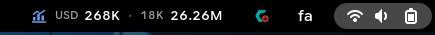
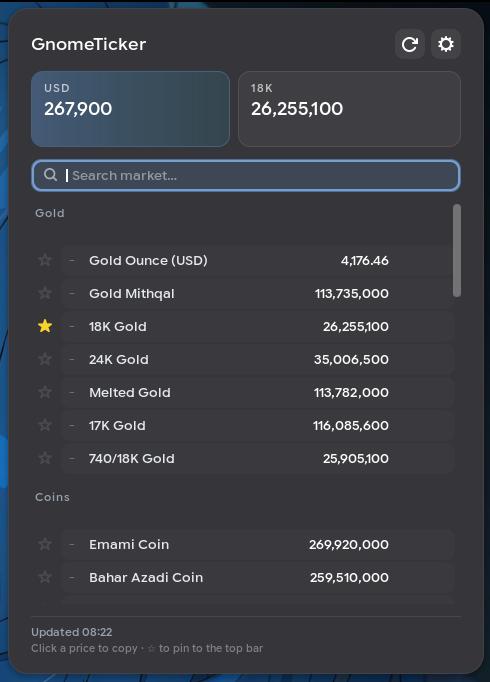
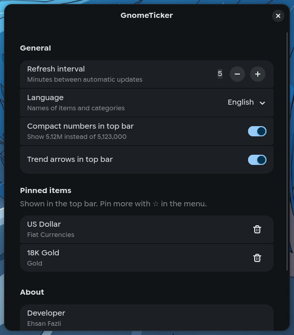

<div align="center">


# GnomeTicker

**Live gold, coin, currency and global-metal prices in your GNOME top bar.**<br>
قیمت لحظه‌ای طلا، سکه، ارز و فلزات جهانی، مستقیم در نوار بالای گنوم.


<br>



<br><br>


&nbsp;&nbsp;&nbsp;


</div>

---

## Features

| | |
| :-- | :-- |
| ⭐ **Pin to the top bar** | Tap ☆ on any item to pin it (up to 3). Pinned items show in the top bar and as cards at the top of the menu. Defaults: USD and 18K Gold. |
| 📊 **Trends** | ▲/▼ arrows and % change since the last price movement. They stay visible until the price moves again. |
| 🔍 **Instant search** | The menu opens with search focused. Works in English and Persian; <kbd>Esc</kbd> clears it. |
| 📋 **Click to copy** | Click any price to copy the raw number, with a "Copied ✓" confirmation. |
| 📴 **Offline-friendly** | Last prices are cached and shown immediately after login. Failed requests retry every minute and keep the old data visible with an "Offline" notice. |
| ⚙️ **Preferences** | Refresh interval, English / فارسی names, compact numbers, trend arrows, and pinned-item management. |
| ⌨️ **Keyboard friendly** | Every button and row can be focused and activated from the keyboard. |

## Installation

```bash
git clone https://github.com/TssHack/GnomeTicker.git \
  ~/.local/share/gnome-shell/extensions/gnometicker@tsshack
gnome-extensions enable gnometicker@tsshack
```

Then restart GNOME Shell: log out and back in on Wayland, or press <kbd>Alt</kbd>+<kbd>F2</kbd>, type `r`, <kbd>Enter</kbd> on X11.

**From a release:** download `gnometicker@tsshack.zip` from the
[Releases page](https://github.com/TssHack/GnomeTicker/releases) and run
`gnome-extensions install --force gnometicker@tsshack.zip`.

## Usage

| Action | How |
| :-- | :-- |
| Open the market | Click the ticker in the top bar |
| Pin / unpin an item | Click ☆ next to it (max 3) |
| Copy a price | Click the price row |
| Refresh now | Click ⟳ in the menu header |
| Open settings | Click ⚙ in the menu header |

## Development

```
extension.js   top bar indicator and popover
data.js        API URL, translations, UI strings and number helpers (shared with prefs)
prefs.js       preferences window (libadwaita)
schemas/       GSettings schema — run `glib-compile-schemas schemas` after editing
icons/         bundled symbolic icon
```

Watch the logs with:

```bash
journalctl -f -o cat /usr/bin/gnome-shell | grep GnomeTicker
```

Build a ZIP for sharing or extensions.gnome.org:

```bash
gnome-extensions pack --force --extra-source=data.js --extra-source=icons .
```

## Data source

Prices come from `https://catplus.ir/api/tgju`. The extension only reads from this endpoint and sends no personal data.

## Author

**Ehsan Fazli** — [ehsanfazli.ir](https://ehsanfazli.ir) · [@TssHack](https://github.com/TssHack)

## License

MIT — see [LICENSE](LICENSE).
